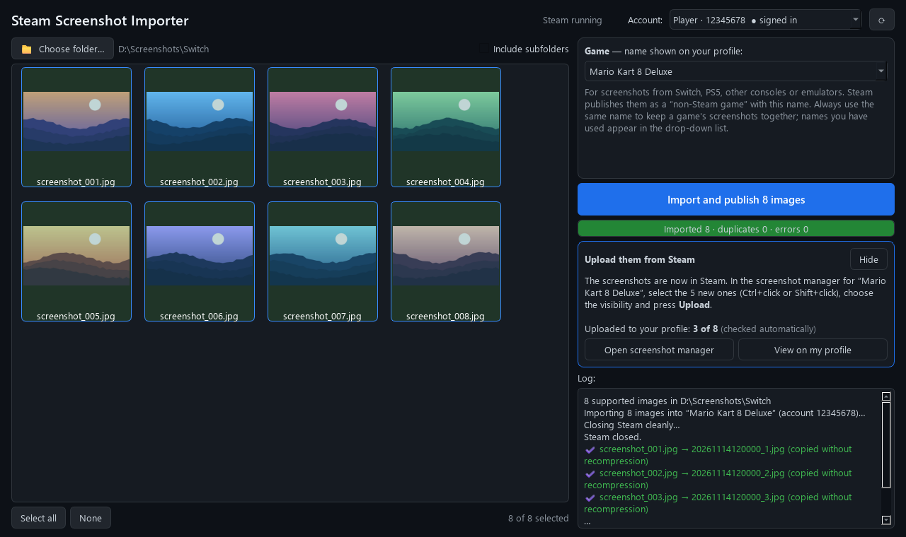

# Steam Screenshot Importer

Windows 10/11 desktop app that imports images from a folder into Steam's screenshot library, ready to publish on your profile with one click.

It is made for **screenshots from consoles (Switch, PS5…) and emulators**: you type the game's name and Steam publishes them as a “non-Steam game” with that name. It replaces the trick of adding VLC as a game, opening the picture and pressing F12. Screenshots of Steam games are uploaded from Steam itself.

Made by **Dreex**.



🇪🇸 *Spanish version at the end of this page.*

## Download

Download `SteamScreenshotImporter.exe` from the [Releases](https://github.com/Dreex14/steam-screenshot-importer/releases/latest) page. No installation and no Python needed.

The executable is not digitally signed, so Windows SmartScreen may show “Windows protected your PC”. Click **More info → Run anyway**. Each release's notes include the SHA-256 so you can check the file.

The interface is in **English and Spanish**: it is chosen automatically from your keyboard layout (Spanish for Spanish or Latin American layouts; English for anything else).

## Usage

1. Open `SteamScreenshotImporter.exe`.
2. Click **Choose folder…**. The gallery shows every supported image, all selected by default (Ctrl/Shift+click to choose).
3. Check the Steam **account** (top right).
4. In **Game**, type the game's name. Names you used before appear in the drop-down list; always use the same name to keep them together.
5. Click **Import and publish**. The app:
   - closes Steam cleanly (`steam.exe -shutdown`) if it is running;
   - backs up `screenshots.vdf`;
   - converts the images, creates the thumbnails and registers them;
   - reopens Steam straight in that game's screenshot manager.
6. **Last step (yours):** in Steam's screenshot manager, select the new screenshots, choose the visibility and press **Upload**.
7. The app checks on its own when Steam has published them (each uploaded screenshot gets a `publishedfileid`) and tells you.

## Why the last click is manual

There is no official way to publish screenshots from an external program:

- Steamworks (`ISteamScreenshots`) only adds screenshots to the local library, and it requires starting the API as if you were playing that game.
- The Steam Web API has no method to upload screenshots.
- The alternatives (internal client APIs through CEF debugging, reusing cookies or sessions, private requests) are fragile or could put the account at risk.

That is why the upload is always done by the **official Steam client with your session**. The app does not use the network, never asks for passwords and does not handle cookies or tokens.

## How it works

- Screenshots are stored in `Steam\userdata\<account>\760\remote\<id>\screenshots\` (plus `thumbnails\`) and registered in `Steam\userdata\<account>\760\screenshots.vdf`.
- The `<id>` is a 64-bit identifier in the same format Steam uses for non-Steam shortcuts (`(appid32 << 32) | 0x02000000`). The visible name is stored in the `shortcutnames` section of `screenshots.vdf`. **No** shortcut is added to your library.
- File names are `YYYYMMDDhhmmss_N.jpg` (the photo's EXIF date or, if missing, its modification date). Thumbnails are 200 px wide, like Steam's.
- `steam://open/screenshots/<id>` opens that game's screenshot manager (the same link the client uses internally).

Tested with the November 2026 Steam client: import, display in the manager, uploading one and several screenshots at once, and automatic verification. The screenshot's public page shows the typed name as the game's name.

## Images

- Formats: JPG/JPEG/JFIF, PNG, WEBP, BMP, TIFF, GIF (first frame) and TGA, plus AVIF if Pillow supports it.
- A compatible JPEG (RGB, baseline, no EXIF, within limits) is copied without recompression. Everything else is converted to quality-95 JPEG without chroma subsampling, applying the EXIF rotation.
- **Privacy:** converting removes EXIF metadata (GPS, camera…), since screenshots may end up public.
- Images larger than 16000 px per side or 26,210,175 pixels (Steam Cloud limits) are scaled down keeping the aspect ratio.
- Transparency is filled with black.
- **Originals are never modified or deleted.**
- Duplicates are detected by SHA-256, both within the selection and against earlier imports to the same game and account (if the screenshot still exists in Steam).

## Safety and recovery

- The library is only changed while Steam is **closed**, so the client cannot overwrite the changes or corrupt the file.
- `screenshots.vdf` is backed up before every import (the last 30 are kept).
- Atomic writes: the file is written to a temporary file, validated and then swapped in.
- An existing Steam file is never overwritten.
- If an import fails or is interrupted (crash, power cut…), it is undone: the copied files are removed and `screenshots.vdf` is restored. If the app closed halfway, it offers to undo it the next time it starts.
- Only the selected account's folder is touched.

App data is kept in `%LOCALAPPDATA%\SteamScreenshotImporter\`: `logs\`, `backups\`, `imported.json` (duplicate register) and `settings.json`.

## Limitations

- Steam must be closed during the import (a few seconds); the app does it for you.
- To publish, Steam must be signed in with the selected account.
- The “Upload” step is manual, for the reasons above.

## Development

```bash
pip install -r requirements.txt
python run.py
```

To build `dist\SteamScreenshotImporter.exe` (PyInstaller, single file):

```bash
build.bat
```

Layout:

```
run.py                       entry point
steamshot/core/steam.py      Steam installation, accounts, closing/opening the client
steamshot/core/vdf.py        reading/writing the KeyValues format (.vdf/.acf)
steamshot/core/images.py     detection, conversion, limits and thumbnails
steamshot/core/importer.py   import, duplicates, backup and recovery
steamshot/core/publish.py    opening Steam's manager and verifying publication
steamshot/core/common.py     paths, logs, backups, duplicate register
steamshot/ui/main_window.py  interface (PySide6)
steamshot/i18n.py            English and Spanish texts
```

## License

This project's code is released under the MIT license; see [LICENSE](LICENSE).

Disclaimer: the author is not responsible for how this program is used or for the images published with it. It is not affiliated with Valve or Steam. Use it at your own risk and follow the Steam Community content rules.

### Dependencies and credits

| Component | Use | License |
|---|---|---|
| [PySide6 / Qt for Python](https://doc.qt.io/qtforpython/) | User interface | LGPL-3.0 |
| [Pillow](https://python-pillow.org/) | Image processing | MIT-CMU (HPND) |
| [PyInstaller](https://pyinstaller.org/) | Building the executable | GPL-2.0 with bootloader exception |

References studied, no code copied:

- [SteaScree](https://github.com/awthwathje/SteaScree) (GPL-3.0, archived): the format of `screenshots.vdf` entries and Steam's size limits.
- [SnapSteam](https://github.com/ihainan/SnapSteam) (ISC): the folders used for non-Steam games.

This app is an original Python reimplementation. It adds names for games from other platforms without creating shortcuts, backups with recovery, duplicate detection, opening the screenshot manager directly, and real verification of publication.

---

<details>
<summary><b>🇪🇸 Leer en español</b></summary>

<br>

Aplicación de escritorio para Windows 10/11 que importa imágenes de una carpeta a la biblioteca de capturas de Steam y las deja listas para publicarlas en tu perfil con un solo clic.

Está pensada para **capturas de consolas (Switch, PS5…) y emuladores**: escribes el nombre del juego y Steam las publica como «juego que no es de Steam» con ese nombre. Sustituye el truco de añadir VLC como juego, abrir la foto y pulsar F12. Las capturas de juegos de Steam se suben desde el propio Steam.

Hecho por **Dreex**.


### Descarga

Descarga `SteamScreenshotImporter.exe` desde la página de [Releases](https://github.com/Dreex14/steam-screenshot-importer/releases/latest). No necesita instalación ni Python.

El ejecutable no está firmado digitalmente, así que Windows SmartScreen puede mostrar «Windows protegió su PC». Pulsa **Más información → Ejecutar de todas formas**. En las notas de cada versión tienes el SHA-256 para comprobar el archivo.

La interfaz está en **español e inglés**: se elige sola según la distribución de tu teclado (español si es española o latinoamericana; inglés en cualquier otro caso).

### Uso

1. Abre `SteamScreenshotImporter.exe`.
2. Pulsa **Elegir carpeta…**. La galería muestra todas las imágenes compatibles, seleccionadas por defecto (Ctrl/Mayús+clic para elegir).
3. Comprueba la **cuenta** de Steam (arriba a la derecha).
4. En **Juego**, escribe el nombre del juego. Los nombres usados antes aparecen en el desplegable; usa siempre el mismo para agruparlas.
5. Pulsa **Importar y publicar**. La aplicación:
   - cierra Steam de forma ordenada (`steam.exe -shutdown`) si está abierto;
   - hace una copia de seguridad de `screenshots.vdf`;
   - convierte las imágenes, genera las miniaturas y las registra;
   - vuelve a abrir Steam directamente en el gestor de capturas de ese juego.
6. **Último paso (tuyo):** en el gestor de Steam, selecciona las capturas nuevas, elige la visibilidad y pulsa **Subir**.
7. La aplicación comprueba sola cuándo Steam las ha publicado (cada captura subida recibe un `publishedfileid`) y te lo indica.

### Por qué hay un último clic manual

No existe ninguna forma oficial de publicar capturas desde un programa externo:

- Steamworks (`ISteamScreenshots`) solo añade capturas a la biblioteca local, y además exige iniciar la API como si estuvieras jugando a ese juego.
- La Web API de Steam no tiene ningún método para subir capturas.
- Las alternativas (API internas del cliente vía depuración CEF, reutilizar cookies o sesiones, peticiones privadas) son frágiles o pueden poner en riesgo la cuenta.

Por eso la subida la hace siempre el **cliente oficial de Steam con tu sesión**. La aplicación no toca la red, no pide contraseñas y no maneja cookies ni tokens.

### Cómo funciona

- Las capturas se guardan en `Steam\userdata\<cuenta>\760\remote\<id>\screenshots\` (más `thumbnails\`) y se registran en `Steam\userdata\<cuenta>\760\screenshots.vdf`.
- El `<id>` es un identificador de 64 bits con el mismo formato que los accesos directos de Steam (`(appid32 << 32) | 0x02000000`). El nombre visible se guarda en la sección `shortcutnames` de `screenshots.vdf`. **No** se crea ningún acceso directo en tu biblioteca.
- Nombres de archivo `AAAAMMDDhhmmss_N.jpg` (fecha EXIF de la foto o, si no la tiene, la de modificación). Miniaturas de 200 px de ancho, como las de Steam.
- `steam://open/screenshots/<id>` abre el gestor de capturas de ese juego (es el mismo enlace que usa el cliente internamente).

Probado con el cliente de Steam de noviembre de 2026: importación, visualización en el gestor, subida de una y de varias capturas a la vez, y la verificación automática. La página pública de la captura muestra el nombre escrito como nombre del juego.

### Imágenes

- Formatos: JPG/JPEG/JFIF, PNG, WEBP, BMP, TIFF, GIF (primer fotograma) y TGA, además de AVIF si Pillow lo soporta.
- Un JPEG compatible (RGB, baseline, sin EXIF, dentro de los límites) se copia sin recomprimir. El resto se convierte a JPEG calidad 95 sin submuestreo de color, aplicando la rotación EXIF.
- **Privacidad:** al convertir se eliminan los metadatos EXIF (GPS, cámara…), ya que las capturas pueden acabar siendo públicas.
- Las imágenes de más de 16000 px por lado o más de 26 210 175 píxeles (límites de la nube de Steam) se reducen manteniendo la proporción.
- La transparencia se rellena con negro.
- **Los originales nunca se modifican ni se borran.**
- Duplicados: se detectan por SHA-256, tanto dentro de la selección como respecto a importaciones anteriores al mismo juego y cuenta (si la captura sigue existiendo en Steam).

### Seguridad y recuperación

- Solo se modifica la biblioteca con Steam **cerrado**, para que el cliente no sobrescriba los cambios ni se corrompa el archivo.
- Hay una copia de seguridad de `screenshots.vdf` antes de cada importación (se guardan las 30 últimas).
- Escritura atómica: se escribe en un archivo temporal, se valida y se reemplaza el original.
- Nunca se sobrescribe un archivo existente de Steam.
- Si la importación falla o se interrumpe (cierre inesperado, corte de luz…), se deshace: se borran los archivos copiados y se restaura `screenshots.vdf`. Si la app se cerró a mitad, ofrece deshacerlo al abrirse de nuevo.
- Solo se toca la carpeta de la cuenta elegida.

Datos de la aplicación en `%LOCALAPPDATA%\SteamScreenshotImporter\`: `logs\`, `backups\`, `imported.json` (registro de duplicados) y `settings.json`.

### Limitaciones

- Steam debe cerrarse durante la importación (unos segundos); la app lo hace sola.
- Para publicar, la sesión abierta en Steam tiene que ser la de la cuenta elegida.
- El paso «Subir» es manual, por los motivos explicados arriba.

### Desarrollo

```bash
pip install -r requirements.txt
python run.py
```

Para generar el ejecutable `dist\SteamScreenshotImporter.exe` (PyInstaller, un solo archivo):

```bash
build.bat
```

Estructura:

```
run.py                       punto de entrada
steamshot/core/steam.py      instalación de Steam, cuentas, abrir/cerrar el cliente
steamshot/core/vdf.py        lectura/escritura del formato KeyValues (.vdf/.acf)
steamshot/core/images.py     detección, conversión, límites y miniaturas
steamshot/core/importer.py   importación, duplicados, copia de seguridad y recuperación
steamshot/core/publish.py    apertura del gestor de Steam y verificación de la publicación
steamshot/core/common.py     rutas, logs, copias de seguridad, registro de duplicados
steamshot/ui/main_window.py  interfaz (PySide6)
steamshot/i18n.py            textos en español e inglés
```

### Licencia

El código de este proyecto se distribuye bajo la licencia MIT; consulta [LICENSE](LICENSE).

Exención de responsabilidad: el autor no se hace responsable del uso que se haga de este programa ni de las imágenes que se publiquen con él. No está afiliado a Valve ni a Steam. Usa el programa bajo tu propia responsabilidad y respeta las normas de contenido de la comunidad de Steam.

#### Dependencias y créditos

| Componente | Uso | Licencia |
|---|---|---|
| [PySide6 / Qt for Python](https://doc.qt.io/qtforpython/) | Interfaz gráfica | LGPL-3.0 |
| [Pillow](https://python-pillow.org/) | Procesamiento de imágenes | MIT-CMU (HPND) |
| [PyInstaller](https://pyinstaller.org/) | Generación del ejecutable | GPL-2.0 con excepción para el bootloader |

Referencias estudiadas, sin copiar código:

- [SteaScree](https://github.com/awthwathje/SteaScree) (GPL-3.0, archivado): el formato de las entradas de `screenshots.vdf` y los límites de tamaño de Steam.
- [SnapSteam](https://github.com/ihainan/SnapSteam) (ISC): las carpetas de los juegos que no son de Steam.

Esta aplicación es una reimplementación propia en Python. Añade etiquetas para juegos de otras plataformas sin crear accesos directos, copias de seguridad con recuperación, detección de duplicados, apertura directa del gestor de capturas y verificación real de la publicación.

</details>
