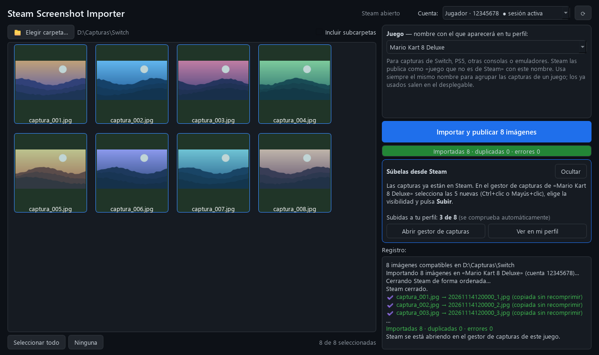

# Steam Screenshot Importer

Aplicación de escritorio para Windows 10/11 que importa imágenes de una carpeta a la biblioteca de capturas de Steam y las deja listas para publicarlas en tu perfil con un solo clic.

Está pensada para **capturas de consolas (Switch, PS5…) y emuladores**: escribes el nombre del juego y Steam las publica como «juego que no es de Steam» con ese nombre. Sustituye el truco de añadir VLC como juego, abrir la foto y pulsar F12. Las capturas de juegos de Steam se suben desde el propio Steam.

Hecho por **Dreex**.



## Descarga

Descarga `SteamScreenshotImporter.exe` desde la página de [Releases](https://github.com/Dreex14/steam-screenshot-importer/releases/latest). No necesita instalación ni Python.

El ejecutable no está firmado digitalmente, así que Windows SmartScreen puede mostrar «Windows protegió su PC». Pulsa **Más información → Ejecutar de todas formas**. En las notas de cada versión tienes el SHA-256 para comprobar el archivo.

La interfaz está en **español e inglés**: se elige sola según la distribución de tu teclado (español si es española o latinoamericana; inglés en cualquier otro caso).

## Uso

1. Abre `SteamScreenshotImporter.exe`.
2. Pulsa **Elegir carpeta…**. La galería muestra todas las imágenes compatibles, seleccionadas por defecto (Ctrl/Mayús+clic para elegir).
3. Comprueba la **cuenta** de Steam (arriba a la derecha).
4. En **Juego**, escribe el nombre del juego. Los nombres usados antes aparecen en el desplegable; usa siempre el mismo para agruparlas.
5. Pulsa **Importar y publicar**. La aplicación:
   - cierra Steam de forma ordenada (`steam.exe -shutdown`) si está abierto;
   - hace una copia de seguridad de `screenshots.vdf`;
   - convierte las imágenes, genera las miniaturas y las registra;
   - vuelve a abrir Steam directamente en el gestor de capturas de ese juego.
6. **Último paso (tuyo):** en el gestor de Steam, selecciona las capturas nuevas, elige la visibilidad y pulsa **Subir**.
7. La aplicación comprueba sola cuándo Steam las ha publicado (cada captura subida recibe un `publishedfileid`) y te lo indica.

## Por qué hay un último clic manual

No existe ninguna forma oficial de publicar capturas desde un programa externo:

- Steamworks (`ISteamScreenshots`) solo añade capturas a la biblioteca local, y además exige iniciar la API como si estuvieras jugando a ese juego.
- La Web API de Steam no tiene ningún método para subir capturas.
- Las alternativas (API internas del cliente vía depuración CEF, reutilizar cookies o sesiones, peticiones privadas) son frágiles o pueden poner en riesgo la cuenta.

Por eso la subida la hace siempre el **cliente oficial de Steam con tu sesión**. La aplicación no toca la red, no pide contraseñas y no maneja cookies ni tokens.

## Cómo funciona

- Las capturas se guardan en `Steam\userdata\<cuenta>\760\remote\<id>\screenshots\` (más `thumbnails\`) y se registran en `Steam\userdata\<cuenta>\760\screenshots.vdf`.
- El `<id>` es un identificador de 64 bits con el mismo formato que los accesos directos de Steam (`(appid32 << 32) | 0x02000000`). El nombre visible se guarda en la sección `shortcutnames` de `screenshots.vdf`. **No** se crea ningún acceso directo en tu biblioteca.
- Nombres de archivo `AAAAMMDDhhmmss_N.jpg` (fecha EXIF de la foto o, si no la tiene, la de modificación). Miniaturas de 200 px de ancho, como las de Steam.
- `steam://open/screenshots/<id>` abre el gestor de capturas de ese juego (es el mismo enlace que usa el cliente internamente).

Probado con el cliente de Steam de noviembre de 2026: importación, visualización en el gestor, subida de una y de varias capturas a la vez, y la verificación automática. La página pública de la captura muestra el nombre escrito como nombre del juego.

## Imágenes

- Formatos: JPG/JPEG/JFIF, PNG, WEBP, BMP, TIFF, GIF (primer fotograma) y TGA, además de AVIF si Pillow lo soporta.
- Un JPEG compatible (RGB, baseline, sin EXIF, dentro de los límites) se copia sin recomprimir. El resto se convierte a JPEG calidad 95 sin submuestreo de color, aplicando la rotación EXIF.
- **Privacidad:** al convertir se eliminan los metadatos EXIF (GPS, cámara…), ya que las capturas pueden acabar siendo públicas.
- Las imágenes de más de 16000 px por lado o más de 26 210 175 píxeles (límites de la nube de Steam) se reducen manteniendo la proporción.
- La transparencia se rellena con negro.
- **Los originales nunca se modifican ni se borran.**
- Duplicados: se detectan por SHA-256, tanto dentro de la selección como respecto a importaciones anteriores al mismo juego y cuenta (si la captura sigue existiendo en Steam).

## Seguridad y recuperación

- Solo se modifica la biblioteca con Steam **cerrado**, para que el cliente no sobrescriba los cambios ni se corrompa el archivo.
- Hay una copia de seguridad de `screenshots.vdf` antes de cada importación (se guardan las 30 últimas).
- Escritura atómica: se escribe en un archivo temporal, se valida y se reemplaza el original.
- Nunca se sobrescribe un archivo existente de Steam.
- Si la importación falla o se interrumpe (cierre inesperado, corte de luz…), se deshace: se borran los archivos copiados y se restaura `screenshots.vdf`. Si la app se cerró a mitad, ofrece deshacerlo al abrirse de nuevo.
- Solo se toca la carpeta de la cuenta elegida.

Datos de la aplicación en `%LOCALAPPDATA%\SteamScreenshotImporter\`: `logs\`, `backups\`, `imported.json` (registro de duplicados) y `settings.json`.

## Limitaciones

- Steam debe cerrarse durante la importación (unos segundos); la app lo hace sola.
- Para publicar, la sesión abierta en Steam tiene que ser la de la cuenta elegida.
- El paso «Subir» es manual, por los motivos explicados arriba.

## Desarrollo

```bash
pip install -r requirements.txt
python run.py
```

Para generar el ejecutable `dist\SteamScreenshotImporter.exe` (PyInstaller, un solo archivo):

```bash
build.bat
```

Estructura:

```
run.py                       punto de entrada
steamshot/core/steam.py      instalación de Steam, cuentas, abrir/cerrar el cliente
steamshot/core/vdf.py        lectura/escritura del formato KeyValues (.vdf/.acf)
steamshot/core/images.py     detección, conversión, límites y miniaturas
steamshot/core/importer.py   importación, duplicados, copia de seguridad y recuperación
steamshot/core/publish.py    apertura del gestor de Steam y verificación de la publicación
steamshot/core/common.py     rutas, logs, copias de seguridad, registro de duplicados
steamshot/ui/main_window.py  interfaz (PySide6)
steamshot/i18n.py            textos en español e inglés
```

## Licencia

El código de este proyecto se distribuye bajo la licencia MIT; consulta [LICENSE](LICENSE).

Exención de responsabilidad: el autor no se hace responsable del uso que se haga de este programa ni de las imágenes que se publiquen con él. No está afiliado a Valve ni a Steam. Usa el programa bajo tu propia responsabilidad y respeta las normas de contenido de la comunidad de Steam.

### Dependencias y créditos

| Componente | Uso | Licencia |
|---|---|---|
| [PySide6 / Qt for Python](https://doc.qt.io/qtforpython/) | Interfaz gráfica | LGPL-3.0 |
| [Pillow](https://python-pillow.org/) | Procesamiento de imágenes | MIT-CMU (HPND) |
| [PyInstaller](https://pyinstaller.org/) | Generación del ejecutable | GPL-2.0 con excepción para el bootloader |

Referencias estudiadas, sin copiar código:

- [SteaScree](https://github.com/awthwathje/SteaScree) (GPL-3.0, archivado): el formato de las entradas de `screenshots.vdf` y los límites de tamaño de Steam.
- [SnapSteam](https://github.com/ihainan/SnapSteam) (ISC): las carpetas de los juegos que no son de Steam.

Esta aplicación es una reimplementación propia en Python. Añade etiquetas para juegos de otras plataformas sin crear accesos directos, copias de seguridad con recuperación, detección de duplicados, apertura directa del gestor de capturas y verificación real de la publicación.
